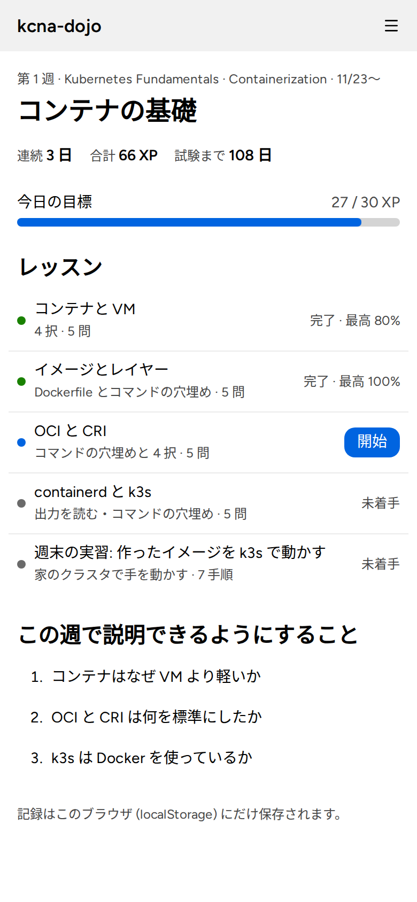
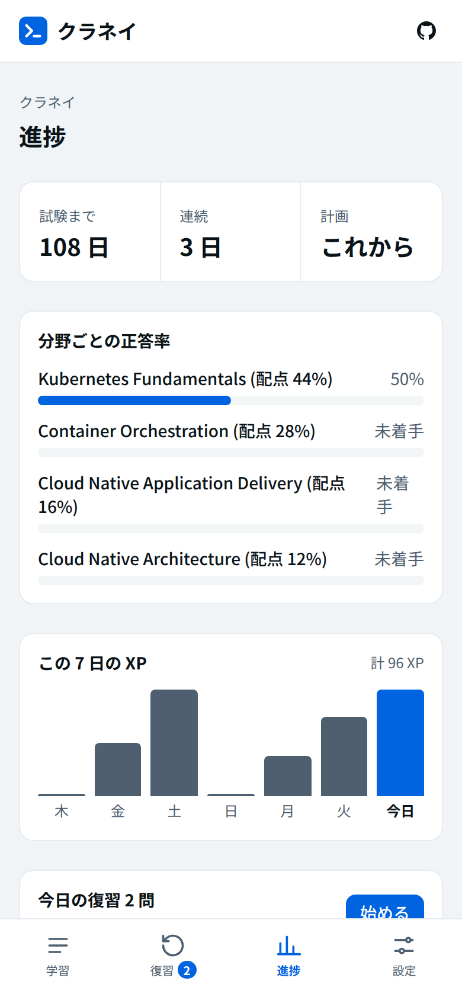
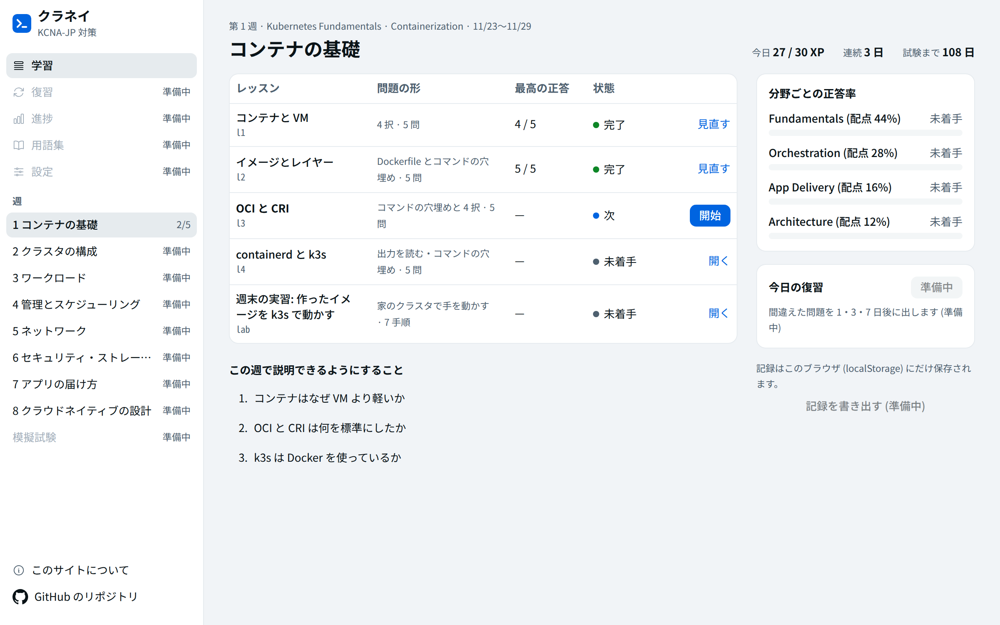
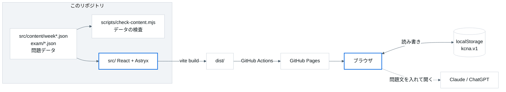
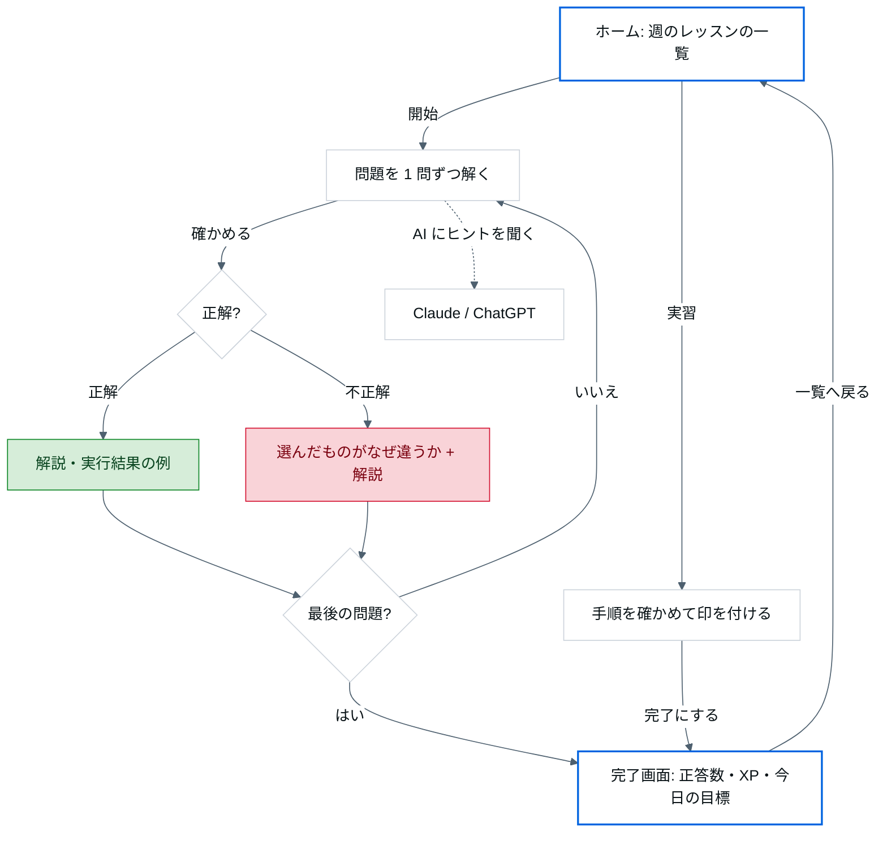

<picture>
  <source media="(prefers-color-scheme: dark)" srcset="docs/images/banner-dark.png">
  
</picture>

**クラネイ** (クラウドネイティブの略) は、KCNA-JP (Kubernetes and Cloud Native Associate 日本語版) 対策の非公式の学習サイト。リポジトリ名は kcna-dojo。週ごとのレッスンで、コマンドの穴埋め・Dockerfile や YAML の穴埋め・4 択・家のクラスタでの実習を解く。間違えた問題は 1・3・7 日後に復習で出し、本番に近い 60 問・90 分の模擬試験と、問題に出る用語の用語集もある。進捗はブラウザの localStorage にだけ残し、サーバーは持たない。

| | |
|---|---|
| サイト | https://maco165.github.io/kcna-dojo/ (サイト名と副題の正本は `src/lib/site.ts`) |
| 見た目 | Meta の [Astryx](https://github.com/meta/astryx) (`@astryxdesign/core` の既定のトークンとシステムの字体)。デザイン案 https://claude.ai/artifact/TbAxSiWzdcuoxPPD155A6T に合わせる |
| 管理 | [AI-Repository](https://github.com/maco165/AI-Repository) の PJ-028 (要件と backlog は `projects/PJ-028-kcna-dojo/design/`) |

この README は設計書を兼ねる。作りを変えたら、同じ PR でここと図と画像を直す (画像は `npm run readme:images`)。

## 画面

<table>
  <tr>
    <td width="33%"></td>
    <td width="33%"></td>
    <td width="33%"></td>
  </tr>
  <tr>
    <td>ホーム。まだ終えていない最初のレッスンだけが「開始」になる</td>
    <td>コマンドの穴埋め。打っても候補を押しても入り、正解のあと実行結果の例が出る</td>
    <td>不正解のときは、選んだものがなぜ違うかを先に出し、解説と出典を続ける</td>
  </tr>
</table>

<table>
  <tr>
    <td width="25%"></td>
    <td width="25%"></td>
    <td width="25%"></td>
    <td width="25%"></td>
  </tr>
  <tr>
    <td>復習。間違えた問題を 1・3・7 日後に出す</td>
    <td>進捗。計画との差と、分野ごとの正答率を見る</td>
    <td>模擬試験。4 分野の配点の割合で 60 問・90 分。途中では正誤を見せない</td>
    <td>用語集。語と説明の 1 行目の一覧を押して開く。分野で絞り、出てくるレッスンへ飛べる</td>
  </tr>
</table>



設定 (目標 XP・受験日・記録の書き出しと読み込み・記録を消す) は `docs/images/settings-phone.png`。

## 全体の作り



- 画面は 10 個。ホーム (`/week/<n>/`)、レッスン (`/lesson/<id>/`)、復習 (`/review/`)、進捗 (`/progress/`。試験までの日数・連続日数・計画との差・分野ごとの正答率・7 日の XP・週ごとの進み具合)、設定 (`/settings/`。目標・受験日・画面の色 (端末に合わせる・ライト・ダーク。この端末の見た目の設定で、記録を読み込んでも変えない)・記録の書き出しと読み込み・記録を消す)、模擬試験 (`/exam/`。4 分野の配点の割合で 60 問・90 分、最後にまとめて採点し、間違いは復習へ。問題の決まった第 1〜5 回 (`src/content/examSets.json`) とランダムがある。第 1〜3 回とランダムはレッスンの問題から、第 4・5 回はレッスンに無い初見の問題 (`src/content/exam/*.json`) から出す)、用語集 (`/glossary/`。問題に出る用語の説明・出典・出てくるレッスン。データは `src/content/glossary.json` で、形は `tests/glossary.test.ts` が検査する)、Kubernetes とこのサイト (`/guide/`。何を学ぶのか・試験の目的と形式・出題範囲・問題の作り方と出典の内訳。試験の事実と出典の正本は `src/content/guide.ts`、数は問題データから `src/lib/contentStats.ts` が数える)、ハンドブック (`/handbook/`、`/handbook/<id>/`。学習要領の細目 13 個ごとに、公式ドキュメントに沿ってコマンドと出力の例で流れを説明し、名前空間 try-kcna で試す手順・練習のレッスン・出典を付ける。最後に、資格の範囲の外だが一緒に知っておいて損がないことを「範囲外」の段に分けて置く (Kubernetes をもっと知る・Linux とコンテナ・コミュニティ・作って届ける・クラウドの 5 段、13 トピック。`5-1-kubernetes.json`〜`5-5-cloud.json`、domain は「付録: 段の名前」で細目とは照らさない。段はファイルの名前の順に並ぶ)。データは `src/content/handbook/*.json` で、形は `tests/handbook.test.ts` が検査する)、このサイトについて (`/about/`)。計画との差は、週の終わりの日曜を過ぎた週の問題のレッスンで数え、実習は遅れに入れず残りの数だけ添える。スマホ (768px 未満) は上の帯と下のタブ、PC は左の一覧と右の欄にする。URL は `#` の無い形 (`/kcna-dojo/handbook/<id>/` など) で、History API で切り替える (`src/lib/route.ts`)。検索エンジンは `#` の後ろを別のページとして扱わないため。前の形の `#/...` の URL は、開いたときに同じページの新しい URL へ置き換える
- 軽さ: ホームとレッスン以外の画面は、開いたときに読む (`src/lib/screens.ts`)。ハンドブックと用語集のデータも、その画面の分と一緒に読む。最初に開いた画面は先に読んでから描き、サイトの中で移るときは読み終えるまで前の画面を出したままにする (白い画面を挟まない)。最初に読む JS の gzip の合計 (380KB まで) と、ハンドブック・用語集・説明のページを最初に読まないことを `npm run e2e` が見張る
- 検索に載る作り: `npm run build` の最後に `scripts/prerender.mjs` が、ページごとの `index.html` (題名・説明・canonical・画面と同じ中身の本文。問題の答えは書かない) と `sitemap.xml` を `dist` に書き出す。書き出したページの URL は、直接開いても 200 で返る (書き出していない URL は 404)。第 1 週はトップと同じ画面なので、リンクはトップを指す。復習・進捗・設定は noindex で sitemap に入れない。用語の 1 語ずつのページは、中身が短いので canonical を用語集の一覧に向ける。robots.txt はドメインの直下 (maco165.github.io リポジトリ) にしか置けないので、そこの `Sitemap:` の行からこの sitemap を指す
- 問題データは JSON で同梱する。足すたびに `npm run check:content` で形を検査する
- 進捗は `src/lib/progress.ts` の関数が読み書きする。関数は保存先と時刻を引数で受け取るので、テストで差し替えられる
- AI に聞くリンクは、問題文を入れた Claude / ChatGPT を新しいタブで開くだけで、サイトからは何も送らない

## 学習の流れ



| 決まり | 中身 |
|---|---|
| 次のレッスン | まだ終えていない最初のレッスンだけが「開始」。ほかのレッスンもいつでも開ける |
| 採点 (`src/lib/grade.ts`) | 穴埋めは前後の空白を無視し、間の空白の並びを 1 つにして比べる。大文字と小文字は区別する (kubectl も YAML の kind も区別するため)。`answers` のどれかに一致すれば正解 |
| 選択肢の並び (`src/lib/shuffle.ts`) | 4 択と穴埋めの候補は、レッスンを開くたび・もう一度解くたびに混ぜる。A〜D は画面の並びで振り、採点と記録は選択肢の id で行う。位置に意味がある問題は `fixedOrder: true` で固定する |
| XP | 1 問正解で 3 XP、実習の完了で 10 XP。レッスンを最後まで解いたときに入る |
| 今日の目標 | 30 XP |
| 連続日数 | レッスンを終えた日が前日の翌日なら 1 増え、1 日以上空くと 1 に戻る。今日も昨日も学んでいなければ 0 と出す |
| AI に聞く (`src/lib/askAi.ts`) | 問題文・コード・候補・選択肢を `https://claude.ai/new?q=` と `https://chatgpt.com/?q=` に入れて開く。答える前は正解を入れずヒントを頼み、答えたあとは自分の答えと正解を添えて説明を頼む。1,500 字で切る |

## 進捗の保存 (localStorage のキー `kcna.v1`)

```json
{
  "v": 1,
  "streak": { "count": 2, "lastDay": "2026-11-24" },
  "xp": { "total": 36, "byDay": { "2026-11-23": 21, "2026-11-24": 15 } },
  "lessons": { "w1-l1": { "done": true, "best": 0.8, "at": "2026-11-23T00:00:00.000Z" } },
  "answers": { "w1-l1-q1": { "right": 1, "wrong": 1, "last": "2026-11-24T00:00:00.000Z" } }
}
```

- 日付は端末の時刻で数える
- 問題文は保存しない。id だけを持つ
- 壊れた JSON や形の違うものが入っていたら、例外を出さずに空の進捗で始める

## 問題データ (`src/content/week<n>.json`)

型の正本は `src/content/types.ts`。検査 (`scripts/check-content.mjs`) は同じ欄を見る。

模擬試験だけに使う初見の問題は `src/content/exam/*.json` に同じ形で置く。週を持たないので `week` は 0 にし、レッスンは id が `x-` で始まる `quiz` だけにする (検査が落とす)。模擬試験と復習の画面を開いたときにだけ読み、最初に読む JS には入れない。復習のバッジの数は、データを読まずに id の `x-` で数える。

| 種類 | 必須の欄 | 説明 |
|---|---|---|
| 共通 | `id` `type` `prompt` `explanation` `source` | `id` は全体で重複しない。`source` は確かめた公式の文書の https の URL |
| `fill` (穴埋め) | `language` (`bash` / `yaml` / `dockerfile`)、`code`、`answers` | `code` に `{{blank}}` をちょうど 1 つ。`candidates` (押して入れる候補。重複しない)、`output` (正解のあとに出す実行結果の例)、`wrongNotes` (候補ごとのなぜ違うか) は任意 |
| `choice` (4 択) | `choices` (`id` と `text`)、`answer` | `answer` は選択肢の `id`。`why` (なぜ違うか)、`code` (出力を読む問題の出力)、`fixedOrder` (混ぜない) は任意。選択肢の文に「A」「B」など位置を書かない |
| 実習 (`kind: lab`) | `steps` (`text`、任意で `command`)、`source` | 全部の手順に印を付けると完了にできる |
| レッスン | `id` `title` `summary` `domain` | `quiz` は 5 問以上。`domain` は試験の 4 分野のどれか |

週の並び・日付・「説明できるようにすること」は `src/content/curriculum.ts`。

問題は公式の文書 (kubernetes.io・docs.k3s.io・opencontainers.org・docs.docker.com) で確かめた内容から書き起こす。実際の試験問題は写さない。

## 開発

```bash
npm ci
npm run dev            # 手元で開く
npm run check:content  # 問題データの検査
npm test               # 採点・進捗・AI のリンク・データ検査・ファビコンのテスト (vitest)
npm run e2e            # 組み立ててブラウザで通しの検査 (Playwright。390 幅と 1280 幅)
npm run build          # 型検査と本番の組み立て
npm run readme:images  # README の見出しと画面の画像を作り直す
```

- テーマ (`src/themes/kcna/kcnaTheme.ts`) はほかのテーマを受け継がず、Astryx の core の既定のトークンをそのまま使い、字体だけシステムの字体にしている (デザイン案が core の既定で描かれているため)。変えたら `npm run astryx -- theme build src/themes/kcna/kcnaTheme.ts` の出力も一緒にコミットし、README の見出しの色 (`scripts/readme-images.mjs` の `TOKENS`) と図の色 (上の `%%{init}%%`) も同じ値に合わせる
- ファビコンの正本は `public/favicon.svg` (強調色の青の角丸の四角に `>_`)。直したら `node scripts/favicons.mjs` で PNG (32px と apple-touch-icon の 180px) を作り直し、一緒にコミットする
- Astryx の部品の使い方は `npm run astryx -- component <名前>` で、入っている版の文書を読む
- main へのマージで GitHub Actions が検査・テスト・組み立てを通し、Pages に配る。PR では配らずに検査だけ走る。e2e と画像の作り直しはブラウザが要るので手元で走らせる

## ライセンス

MIT

Kubernetes と KCNA は The Linux Foundation の商標です。このサイトは The Linux Foundation・CNCF とは関係ありません。
