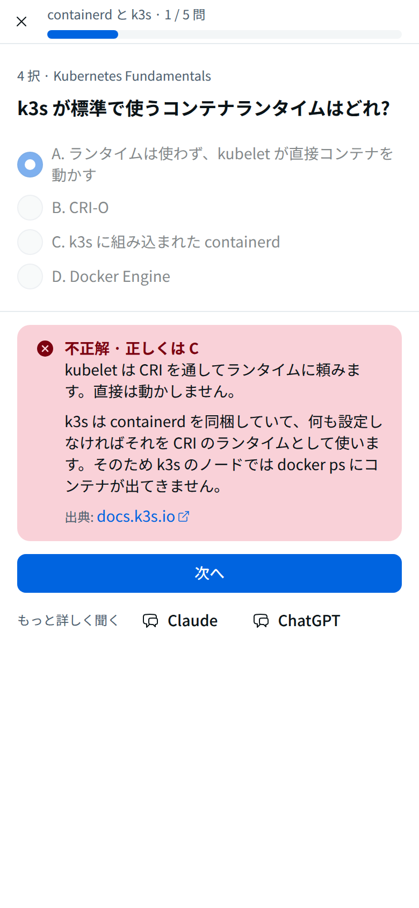
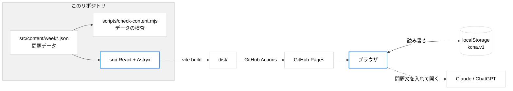
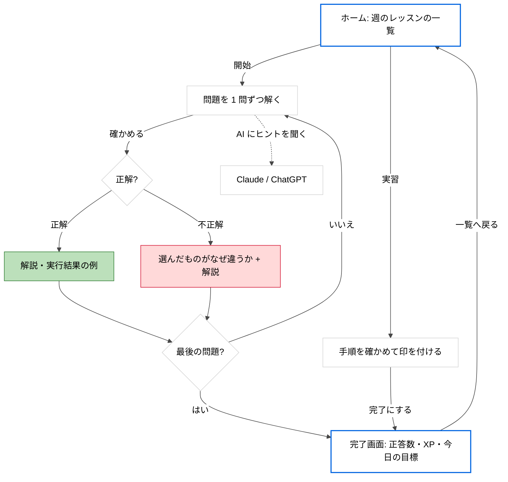

<picture>
  <source media="(prefers-color-scheme: dark)" srcset="docs/images/banner-dark.png">
  
</picture>

KCNA-JP (Kubernetes and Cloud Native Associate 日本語版) の学習サイト。週ごとのレッスンで、コマンドの穴埋め・Dockerfile や YAML の穴埋め・4 択・家のクラスタでの実習を解く。進捗はブラウザの localStorage にだけ残し、サーバーは持たない。

| | |
|---|---|
| サイト | https://maco165.github.io/kcna-dojo/ |
| 見た目 | Meta の [Astryx](https://github.com/meta/astryx) (`@astryxdesign/core` と `theme-neutral`。強調の色だけ core の既定の青) |
| 管理 | [AI-Repository](https://github.com/maco165/AI-Repository) の PJ-028 (要件と backlog は `projects/PJ-028-kcna-dojo/design/`) |

この README は設計書を兼ねる。作りを変えたら、同じ PR でここと図と画像を直す (画像は `npm run readme:images`)。

## 画面

<table>
  <tr>
    <td width="33%"></td>
    <td width="33%"></td>
    <td width="33%"></td>
  </tr>
  <tr>
    <td>ホーム。まだ終えていない最初のレッスンだけが「開始」になる</td>
    <td>コマンドの穴埋め。打っても候補を押しても入り、正解のあと実行結果の例が出る</td>
    <td>不正解のときは、選んだものがなぜ違うかを先に出し、解説と出典を続ける</td>
  </tr>
</table>


## 全体の作り



- 画面は 2 つ。ホーム (`#/week/<n>`) とレッスン (`#/lesson/<id>`)。GitHub Pages ではサーバーで経路を振り分けられないので、URL の `#` の後ろで決める (`src/lib/route.ts`)
- 問題データは JSON で同梱する。足すたびに `npm run check:content` で形を検査する
- 進捗は `src/lib/progress.ts` の関数が読み書きする。関数は保存先と時刻を引数で受け取るので、テストで差し替えられる
- AI に聞くリンクは、問題文を入れた Claude / ChatGPT を新しいタブで開くだけで、サイトからは何も送らない

## 学習の流れ



| 決まり | 中身 |
|---|---|
| 次のレッスン | まだ終えていない最初のレッスンだけが「開始」。ほかのレッスンもいつでも開ける |
| 採点 (`src/lib/grade.ts`) | 穴埋めは前後の空白を無視し、間の空白の並びを 1 つにして比べる。大文字と小文字は区別する (kubectl も YAML の kind も区別するため)。`answers` のどれかに一致すれば正解 |
| XP | 1 問正解で 3 XP、実習の完了で 10 XP。レッスンを最後まで解いたときに入る |
| 今日の目標 | 30 XP |
| 連続日数 | レッスンを終えた日が前日の翌日なら 1 増え、1 日以上空くと 1 に戻る。今日も昨日も学んでいなければ 0 と出す |
| AI に聞く (`src/lib/askAi.ts`) | 問題文・コード・候補・選択肢を `https://claude.ai/new?q=` と `https://chatgpt.com/?q=` に入れて開く。答える前は正解を入れずヒントを頼み、答えたあとは自分の答えと正解を添えて説明を頼む。1,500 字で切る |

## 進捗の保存 (localStorage のキー `kcna.v1`)

```json
{
  "v": 1,
  "streak": { "count": 2, "lastDay": "2026-11-24" },
  "xp": { "total": 36, "byDay": { "2026-11-23": 21, "2026-11-24": 15 } },
  "lessons": { "w1-l1": { "done": true, "best": 0.8, "at": "2026-11-23T00:00:00.000Z" } },
  "answers": { "w1-l1-q1": { "right": 1, "wrong": 1, "last": "2026-11-24T00:00:00.000Z" } }
}
```

- 日付は端末の時刻で数える
- 問題文は保存しない。id だけを持つ
- 壊れた JSON や形の違うものが入っていたら、例外を出さずに空の進捗で始める

## 問題データ (`src/content/week<n>.json`)

型の正本は `src/content/types.ts`。検査 (`scripts/check-content.mjs`) は同じ欄を見る。

| 種類 | 必須の欄 | 説明 |
|---|---|---|
| 共通 | `id` `type` `prompt` `explanation` `source` | `id` は全体で重複しない。`source` は確かめた公式の文書の https の URL |
| `fill` (穴埋め) | `language` (`bash` / `yaml` / `dockerfile`)、`code`、`answers` | `code` に `{{blank}}` をちょうど 1 つ。`candidates` (押して入れる候補。重複しない)、`output` (正解のあとに出す実行結果の例)、`wrongNotes` (候補ごとのなぜ違うか) は任意 |
| `choice` (4 択) | `choices` (`id` と `text`)、`answer` | `answer` は選択肢の `id`。`why` (なぜ違うか) と `code` (出力を読む問題の出力) は任意 |
| 実習 (`kind: lab`) | `steps` (`text`、任意で `command`)、`source` | 全部の手順に印を付けると完了にできる |
| レッスン | `id` `title` `summary` `domain` | `quiz` は 5 問以上。`domain` は試験の 4 分野のどれか |

週の並び・日付・「説明できるようにすること」は `src/content/curriculum.ts`。

問題は公式の文書 (kubernetes.io・docs.k3s.io・opencontainers.org・docs.docker.com) で確かめた内容から書き起こす。実際の試験問題は写さない。

## 開発

```bash
npm ci
npm run dev            # 手元で開く
npm run check:content  # 問題データの検査
npm test               # 採点・進捗・AI のリンク・データ検査のテスト (vitest)
npm run e2e            # 組み立ててブラウザで通しの検査 (Playwright。390 幅と 1280 幅)
npm run build          # 型検査と本番の組み立て
npm run readme:images  # README の見出しと画面の画像を作り直す
```

- テーマを変えるときは `src/themes/kcna/kcnaTheme.ts` を直し、`npm run astryx -- theme build src/themes/kcna/kcnaTheme.ts` の出力も一緒にコミットする。README の見出しの色 (`scripts/readme-images.mjs` の `TOKENS`) と図の色 (上の `%%{init}%%`) も同じ値に合わせる
- ファビコンの正本は `public/favicon.svg` (強調色の青の角丸の四角に `>_`)。直したら `node scripts/favicons.mjs` で PNG (32px と apple-touch-icon の 180px) を作り直し、一緒にコミットする
- Astryx の部品の使い方は `npm run astryx -- component <名前>` で、入っている版の文書を読む
- main へのマージで GitHub Actions が検査・テスト・組み立てを通し、Pages に配る。PR では配らずに検査だけ走る。e2e と画像の作り直しはブラウザが要るので手元で走らせる

## ライセンス

MIT
