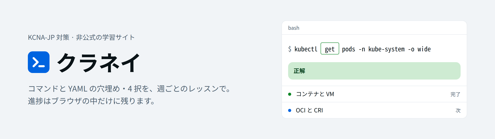
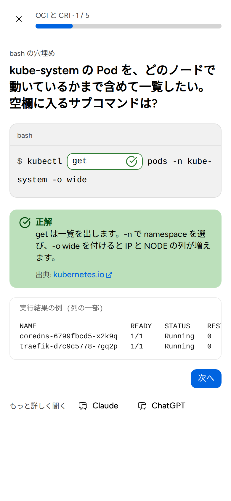
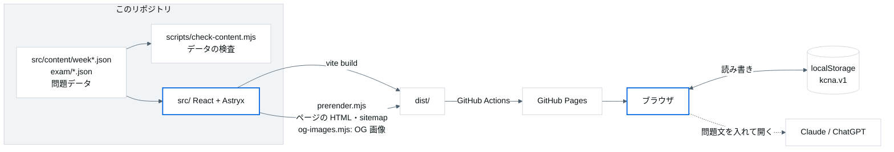
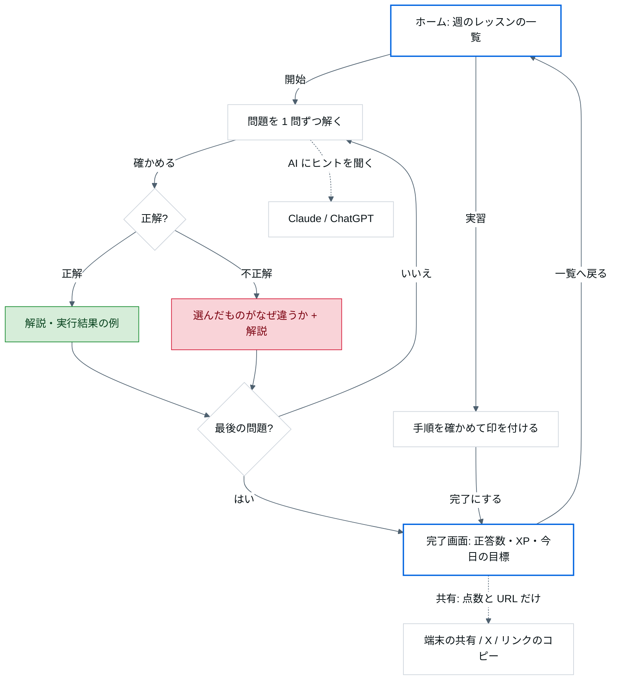

<picture>
  <source media="(prefers-color-scheme: dark)" srcset="docs/images/banner-dark.png">
  
</picture>

**クラネイ** (クラウドネイティブの略) は、KCNA-JP (Kubernetes and Cloud Native Associate 日本語版) 対策の非公式の学習サイト。リポジトリ名は kcna-dojo。週ごとのレッスンで、コマンドの穴埋め・Dockerfile や YAML の穴埋め・4 択・家のクラスタでの実習を解く。間違えた問題は 1・3・7 日後に復習で出し、本番に近い 60 問・90 分の模擬試験と、問題に出る用語の用語集もある。進捗はブラウザの localStorage にだけ残し、サーバーは持たない。

| | |
|---|---|
| サイト | https://maco165.github.io/kcna-dojo/ (サイト名と副題の正本は `src/lib/site.ts`) |
| 見た目 | Meta の [Astryx](https://github.com/meta/astryx) (`@astryxdesign/core` の既定のトークンとシステムの字体)。デザイン案 https://claude.ai/artifact/TbAxSiWzdcuoxPPD155A6T に合わせる |
| 管理 | [AI-Repository](https://github.com/maco165/AI-Repository) の PJ-028 (要件と backlog は `projects/PJ-028-kcna-dojo/design/`) |

この README は設計書を兼ねる。作りを変えたら、同じ PR でここと図と画像を直す (画像は `npm run readme:images`)。

## 画面

<table>
  <tr>
    <td width="33%"></td>
    <td width="33%"></td>
    <td width="33%"></td>
  </tr>
  <tr>
    <td>ホーム。まだ終えていない最初のレッスンだけが「開始」になる</td>
    <td>コマンドの穴埋め。打っても候補を押しても入り、正解のあと実行結果の例が出る</td>
    <td>不正解のときは、選択肢の上に「○ 正解」「× 選んだ答え」の札 (色だけに頼らない印と文字) を付け、選んだものがなぜ違うかを先に出し、解説と出典を続ける</td>
  </tr>
</table>

<table>
  <tr>
    <td width="25%"></td>
    <td width="25%"></td>
    <td width="25%"></td>
    <td width="25%"></td>
  </tr>
  <tr>
    <td>復習。間違えた問題を 1・3・7 日後に出す</td>
    <td>進捗。休みの札・計画との差・分野ごとの正答率・問題ごとの到達・学んだ日のマス・この先 14 日の復習を見る</td>
    <td>模擬試験。4 分野の配点の割合で 60 問・90 分。途中では正誤を見せない。「あとで見直す」の印と問題の一覧がある</td>
    <td>用語集。語と説明の 1 行目の一覧を押して開く。分野で絞り、出てくるレッスンへ飛べる</td>
  </tr>
</table>


設定 (目標 XP・週の目標・受験日・学習の開始日・学ぶ予定の .ics・記録の書き出しと読み込み・記録を消す) は `docs/images/settings-phone.png`。

## 全体の作り



- 画面は 12 個。ホーム (`/week/<n>/`)、レッスン (`/lesson/<id>/`)、復習 (`/review/`)、進捗 (`/progress/`。試験までの日数 (受験日を決めていなければ設定への「受験日を決める」)・連続日数・計画との差・分野ごとの正答率 (レッスンの問題の答えで数える。第 4・5 回の初見の問題は本体を読まないと分野が分からないので入れず、模擬試験の結果で見る)・問題ごとの到達 (レッスンと模擬試験用の問題の全部を、まだ解いていない・間違えた (直近)・1 回正解・2 回続けて正解の 4 つに分け、学習要領の 4 分野ごとに数と割合を文で出し、帯を添える。模擬試験用の問題は `?ids` の形 (`vite.config.ts` の `lightLessons`。問題の id と分野だけ) で読む (`?light` は問題文まで入り、進捗の画面の分が gzip で 8KB 増えたため)。`src/lib/mastery.ts`、参考: Ping-t の到達の一覧)・7 日の XP・学習のまとめのカード (押すと、学んだ期間・学んだ日・解いた問題の数 (答えたことのある問題の数。何度答えても 1 問)・連続日数・分野ごとの到達を canvas で 1080×1350 の PNG に描き、見本と「画像を保存」を出す。ファイルを共有できる端末 (`navigator.canShare({ files })`) では「共有」も出す。名前・端末・受験日・問題の id や答えは描かない。描く部品は進捗の画面の分に入れる (別のチャンクに分けて `React.lazy` で読むと、rolldown が本体の取り込みを切り直し、最初に読むファイルが 13 から 15 本に増えて、どのページも Lighthouse の LCP が約 200ms 延びたため)。`src/lib/summaryCard.ts`)・過去 26 週の学んだ日のマス (月曜始まりで縦に月〜日。学んだ日 (レッスン・復習・模擬試験を終えた日。連続日数・週の目標と同じ) に、その日に答えた問題の数で 1〜5・6〜15・16〜40・41 問からの 4 段を付け、数の記録の無い前の版の学んだ日は 1 段目。答えただけで何も終えていない日は段を付けず、縁だけの印にする。色だけに頼らず、マスごとに日付と数の読み上げと title を付ける。マスの並びは 1 つのフォーカス先で、マスを押すか矢印キー (左右は週、上下は日) で日を選ぶと、その日の日付と数を下に文字で出す (スマホでは title が見えないため)。`src/lib/calendar.ts`、参考: Anki の Calendar)・明日から 14 日の復習の件数 (1・3・7 日後の予定 `nextReview` から数え、問題データに無い id は数えない。参考: Anki の Future Due)・週ごとの進み具合)、設定 (`/settings/`。目標・週の目標 (週に何日学ぶか。`profile.weeklyDays`)・学ぶ予定の .ics のダウンロード・受験日 (決めるまで持たず、ホームと進捗は日数の代わりに「受験日を決める」を出す。前の版で入った受験日はそのまま読む)・学習の開始日 (週の日付の起点。決めなければ初めて学んだ日、まだなら今日。`src/lib/progress.ts` の `planStart`)・画面の色 (端末に合わせる・ライト・ダーク。この端末の見た目の設定で、記録を読み込んでも変えない)・記録の書き出しと読み込み・記録を消す)、模擬試験 (`/exam/`。4 分野の配点の割合で 60 問・90 分、最後にまとめて採点し、間違いは復習へ。問題の決まった第 1〜5 回 (`src/content/examSets.json`) とランダムがある。第 1〜3 回とランダムはレッスンの問題から、第 4・5 回はレッスンに無い初見の問題 (`src/content/exam/*.json`) から出す。解いている途中は、回・問題と選択肢の並び・答え・いまの問題・残り時間の期限 (時刻) を localStorage の別のキー `kcna.exam.v1` に置き (`src/lib/examSave.ts`)、再読み込みや開き直しで「続きから解く / やめて最初から」を出す。閉じている間も時間は進み、期限を過ぎていれば時間切れの結果にする。採点・やめる・記録を消すで保存を消す。保存は回ごとの id を持ち、採点した回の id を `kcna.exam.done.v1` に残して、2 つのタブで同じ回を開いても記録を 2 回付けない (採点済みの保存は捨て、ほかのタブが消した保存は書き戻さない)。案内を開いたまま期限が来ても時間切れの結果にする。解いている間は各問に「あとで見直す」の印を付け外しでき、問題の一覧 (回答済みは塗り・未回答は枠だけ・印は旗。ボタンは「3 問目 回答済み・見直す印あり」のように文字でも読み上げる) から好きな問題へ移れる。採点の前の確かめに未回答と印の数を出し、「続ける」で戻ると一覧を開く。印は途中の保存に番号の並び `marks` で入れ (印が無ければ書かない。前の版の保存は印なしで続きから解ける)、2 つのタブ・期限切れの扱いは同じ保存の書き方 (`saveExam` の `onlyIfCurrent`) を通る)、用語集 (`/glossary/`、`/glossary/<id>/`。問題に出る用語の説明・仕組みの図・出典・出てくるレッスン。一覧で開いた語や、ほかのページの用語のリンクから、語の名前を h1 にした 1 語のページへ行ける。データは `src/content/glossary.json` で、形は `tests/glossary.test.ts` が検査する。図は `src/content/glossaryFigures/*.json` で、関係の深い用語どうしが 1 つの図を共有し、箱の `term` で見ている用語の箱を強調する (主役の色と太い枠。失敗を表す赤い箱は赤のまま枠だけ太くする)。配置 (はみ出し・重なり・線が箱を通らない) は `tests/glossaryFigures.test.ts` がハンドブックの図と同じ検査で見る)、Kubernetes とこのサイト (`/guide/`。何を学ぶのか・試験の目的と形式・出題範囲・問題の作り方と出典の内訳。試験の事実と出典の正本は `src/content/guide.ts`、数は問題データから `src/lib/contentStats.ts` が数える)、ハンドブック (`/handbook/`、`/handbook/<id>/`。学習要領の細目 13 個ごとに、公式ドキュメントに沿ってコマンドと出力の例で流れを説明し、名前空間 try-kcna で試す手順・練習のレッスン・出典を付ける。目次は「試験の範囲」と「範囲外」の 2 部に分け、上に 2 部へ飛ぶリンク (トピックの数と確認済みの数) を置き、カードとトピックの頭に「試験の範囲」か「範囲外」の札を付ける。最後に、資格の範囲の外だが一緒に知っておいて損がないことを「範囲外」の段に分けて置く (Kubernetes をもっと知る・Linux とコンテナ・コミュニティ・作って届ける・クラウドの 5 段、13 トピック。`5-1-kubernetes.json`〜`5-5-cloud.json`、domain は「付録: 段の名前」で細目とは照らさない。段はファイルの名前の順に並ぶ)。設定ファイルのサンプル (main.tf・ワークフロー・Chart.yaml・Dockerfile・kubeconfig など、`code.title` のあるコード) には、項目ごとの意味と公式の出典を付ける (`fields`)。サンプルの項目を `src/lib/codeKeys.ts` が取り出し、意味の抜けと余りを検査で落とす。CI/CD のサンプルはこのリポジトリの `deploy.yml` と同じことをテストで見る。本文の用語 (ページの中で最初の 1 回) は、カーソルかキーボードのフォーカスで用語集の短い意味を吹き出しに出し、クリックで用語集へ移る。タッチは 1 回目のタップで意味を出し、出た意味のタップで移る。吹き出しは 1 ページに 1 つで、イベントは本文の枠でまとめて受け、意味はハンドブックがリンクのために読んでいる用語集のデータを使うので、新しく読むファイルは無い (`src/components/TermTip.tsx`)。データは `src/content/handbook/*.json` で、形は `tests/handbook.test.ts` が検査する)、コマンド (`/commands/`、`/commands/<id>/`。問題に出てくるコマンドごとに、何をするか・書き方・オプション・中で何が起きるか (どの API の要求になり、どの部品が動くか)・送る API の要求・実行の例と出力・kubectl -v で見える要求・実装のソースの抜粋 (版のタグと行つき)・出てくるレッスン・公式リファレンス。何をするか・書き方・オプションは `src/content/commands.json` (答えたあとの「出てきたコマンド」と共通)、残りは `src/content/commandPages/*.json`。形と、家のクラスタの名前・住所を載せていないことは `tests/commandPages.test.ts` が検査する。出力の例は公式の文書か、家の k3s で読むだけのコマンドと --dry-run=server で打ったもの (名前・住所は伏せる)。答えたあとの説明からも飛べる。中身まで書き出した HTML にして sitemap に載せる)、似た語の比較表 (`/compare/`、`/compare/<id>/`。試験で取り違えやすい語の組ごとに、観点を並べた表・取り違えやすい点・違いが見えるコード・出典。データは `src/content/compare.json` で、形は `tests/compare.test.ts` が検査する。列の語は用語集の語に結び、用語集の語からも「似た語と比べる」で飛べる。表まで書き出した HTML にして sitemap に載せる)、このサイトについて (`/about/`)。計画との差は、開始日から 7 日ずつ数えた週の 7 日目を過ぎた週の問題のレッスンで数え、実習は遅れに入れず残りの数だけ添える。スマホ (768px 未満) は上の帯と下のタブ、PC は左の一覧と右の欄にする。URL は `#` の無い形 (`/kcna-dojo/handbook/<id>/` など) で、History API で切り替える (`src/lib/route.ts`)。検索エンジンは `#` の後ろを別のページとして扱わないため。前の形の `#/...` の URL は、開いたときに同じページの新しい URL へ置き換える
- 軽さ: ホーム以外の画面は、開いたときに読む (`src/lib/screens.ts`)。ハンドブックと用語集のデータも、その画面の分と一緒に読む。週の問題のファイルは、ホームと本体では `?light` を付けて問題を id・形・問題文だけにした軽い形で読み (`vite.config.ts` の `lightLessons`、`src/content/curriculum.ts`)、選択肢・正解・解説・出典までの全文は `src/content/lessons.ts` から、レッスン・復習・模擬試験・説明のページを開いたときに読む。最初に開いた画面は先に読んでから描き、サイトの中で移るときは読み終えるまで前の画面を出したままにする (白い画面を挟まない)。画面の部品を読めなければページごと 1 回だけ読み直す (`reloadOnce`)。答えたあとの読み直す先などの後から読む部品 (`React.lazy`) は `src/components/LoadBoundary.tsx` の `LazyPart` で受け止め、読めなければその部品だけ出さない。画面の全体は `LoadBoundary` で受け止め、「画面を読み込めませんでした / 読み直す」を出す (新しい版を出したあとの開いたままのタブで古いチャンクが 404 になっても、白紙にしない。`npm run e2e` が見る)。トップが最初に読む JS (script と modulepreload) の gzip -9 の合計 (250KB まで。2026-11-22 に 326KB から 240KB にした) と、ハンドブック・用語集・説明のページ・模擬試験用の問題・比較表・コマンドのページ・週の問題の全文を最初に読まないことを `npm run e2e` が見張る。描画を止める CSS は、Astryx の CSS から、このサイトが取り込む部品 (取り込みをたどった全部) のコードに出てこない StyleX のクラスだけの規則を除いて軽くする (`vite.config.ts` の `purgeStylex`。CSS を読む時点で除くので、出力の名前の hash も除いたあとの中身で決まる)。`src/content` の JSON は `JSON.parse` の文字列の module にして読む (`jsonParse`。V8 はオブジェクトの書き方より速く読む)。ハンドブックのコードは、画面の外では CodeBlock と同じ大きさの軽い `<pre>` で出し、画面に近づくと CodeBlock (色分け・コピー) に替える (`src/components/LazyCodeBlock.tsx`)。用語集のスマホの一覧の行は `content-visibility: auto` で画面の外の配置を省く (書き出した HTML の本文に付けると、最初の描画に入らず LCP が遅れたので付けない。ハンドブックの流れの段も、「続きから」の送り先がずれるので付けない)。CSS の大きさ (gzip 40KB まで)・JS が付けるクラスを CSS から落としていないこと・データのチャンクが `JSON.parse` で読むこと・ハンドブックのコードが画面の外では軽い表示なことも `npm run e2e` が見る
- 検索に載る作り: `npm run build` の最後に `scripts/prerender.mjs` が、ページごとの `index.html` (題名・説明・canonical・画面と同じ中身の本文。問題の答えは書かない) と `sitemap.xml` を `dist` に書き出す。書き出したページの URL は、直接開いても 200 で返る (書き出していない URL は 404)。第 1 週はトップと同じ画面なので、リンクはトップを指す。復習・進捗・設定は noindex で sitemap に入れない。用語の 1 語ずつのページ (`/glossary/<id>/`) は、画面と同じ中身 (説明・詳しい説明・似た語と比べる・ハンドブック・出てくるレッスン・出典) を書き出して sitemap に載せる (一覧の語・レッスンの「出てくる用語」・比較表の列の語はこのページへリンクする)。題名はトップだけ「クラネイ — KCNA-JP 対策」で、ほかは「ページの名前 | クラネイ」(`src/lib/pageTitle.ts` の `withSite`。画面の document.title と同じ関数)。35 字を超えるときは名前だけにし、名前だけでも超えるものはデータに短い名前 `short` を持つ。検索に載るページ (noindex でなく canonical が自分) は、本文の頭に見えるパンくず (トップ › 一覧か週 › ページ。第 1 週のレッスンはトップの下) と、同じ階層の BreadcrumbList の JSON-LD を持ち (画面も `src/components/Crumbs.tsx` で同じ階層のパンくずをトップから出す。ハンドブックの段とコマンドの道具は、画面ではリンクの無い項目として間に出す。レッスンを解く画面は上の帯で週へ戻るので出さない)、ハンドブック・コマンド・比較表のページは TechArticle、用語集は DefinedTermSet、用語の 1 語ずつのページは DefinedTerm (`inDefinedTermSet` で用語集を指す)、レッスンは LearningResource も持つ。WebSite の JSON-LD はトップだけ。画面が描いたあとの h1 も書き出した h1 と同じにする (トップはサイト名で週の名前は h2、第 2 週からは「第 n 週 週の名前」、レッスンの画面は上の帯のレッスン名で問題文は h2、用語のページは語の名前。模擬試験の途中は問題文が h1 のまま。`npm run e2e` が見る)。レッスンの本文には、答える前に画面に出るもの (問題文・コード・選択肢・候補) を書き、選択肢と候補は文字の順に並べる (データの並びは正解が前に寄るため)。題名が重ならないこと・35 字以内・構造化データ・パンくず・h2・模擬試験とこのサイトについてと全レッスンの本文 400 字以上を `tests/pages.test.ts` が見る。robots.txt はドメインの直下 (maco165.github.io リポジトリ) にしか置けないので、そこの `Sitemap:` の行からこの sitemap を指す
- ページごとの OG 画像: `scripts/prerender.mjs` の最後に `scripts/og-images.mjs` が、検索に載る各ページ (レッスン・週・ハンドブック・用語・コマンド・比較表・説明・模擬試験・このサイトについて) の題名入りの 1200×630 の PNG を `dist/og/<道を - でつないだ名前>.png` に描き、そのページの `og:image`・`twitter:image`・`og:image:alt` にする。トップ・noindex のページ・404 はサイト共通の `og-image.png` のまま。描き方は node だけ: npm の Noto Sans JP の TTF (`@expo-google-fonts/noto-sans-jp`、OFL) を opentype.js で読み、文字を形 (path) にした SVG を resvg (`@resvg/resvg-js`) で PNG にする (ブラウザも OS の字体も使わないので、Playwright の無い CI でも手元と同じ絵)。描く前に、描くすべての文字が字体にあることを確かめ、無ければ書き出しを止める (字形の欠けを出さない。`tests/ogImages.test.ts` も全ページで見る)。題名は 64・56・48 の大きさで 3 行に収め、説明は 2 行で … で切る。英数字の語の途中では切らず、行の頭に句読点を置かない。絵は 256 色以下なので、色を落とさないパレットの PNG にして書く (resvg の PNG の半分以下。2026-11-23 に 264 枚・6.3MB)
- 問題データは JSON で同梱する。足すたびに `npm run check:content` で形を検査する
- 進捗は `src/lib/progress.ts` の関数が読み書きする。関数は保存先と時刻を引数で受け取るので、テストで差し替えられる
- AI に聞くリンクは、問題文を入れた Claude / ChatGPT を新しいタブで開くだけで、サイトからは何も送らない

## 学習の流れ



| 決まり | 中身 |
|---|---|
| 次のレッスン | まだ終えていない最初のレッスンだけが「開始」。ほかのレッスンもいつでも開ける |
| 先に読む (`src/content/curriculum.ts` の `read`) | 週の一覧の頭に、その週で先に読むハンドブックのトピックへのリンクを出す。レッスンは問題から始まり導入の本文を持たないので、初めての人の入口にする。読まなくてもレッスンは開ける。ホームはハンドブックのデータを読まないので、週ごとにトピックの id と短い呼び名だけを持ち、`tests/preRead.test.ts` が見張る: トピックが実在して試験の範囲であること・呼び名が題名の頭であること・その週のレッスンを練習に持つこと・試験の範囲の 13 トピックがどれかの週に入ること・どのレッスン (実習も) も自分の週のトピックの練習に入ること。学び方 (初めての人は読んでから、触ったことがある人は解いてから読み直す) は `/guide/` の「学び方」に書く |
| 採点 (`src/lib/grade.ts`) | 穴埋めは前後の空白を無視し、間の空白の並びを 1 つにして比べる。大文字と小文字は区別する (kubectl も YAML の kind も区別するため)。`answers` のどれかに一致すれば正解 |
| 選択肢の並び (`src/lib/shuffle.ts`) | 4 択と穴埋めの候補は、レッスンを開くたび・もう一度解くたびに混ぜる。A〜D は画面の並びで振り、採点と記録は選択肢の id で行う。位置に意味がある問題は `fixedOrder: true` で固定する |
| XP | 1 問正解で 3 XP、実習の完了で 10 XP。レッスンを最後まで解いたときに入る |
| 今日の目標 | 30 XP |
| 週の目標 (`src/lib/progress.ts` の `weekProgress`) | 設定で「週に何日学ぶか」(1〜7) を選ぶ。既定は決めず、決めていなければホームに出さない。決めるとホームに今週 (月曜から今日まで) の「今週 n / 目標 日」を出す。学んだ日の数え方は連続日数と同じ (レッスン・復習・模擬試験を終えた日)。参考: Codecademy の Weekly Targets |
| 学ぶ予定の .ics (`src/lib/ics.ts`) | 設定で、時刻と「毎日」か「曜日を選ぶ」(週の目標を決めていれば、その日数に合わせた曜日を先に選んでおく) を選び、30 分の予定を繰り返す .ics をダウンロードする。RFC 5545 に沿う: VEVENT に UID (乱数と時刻)・DTSTAMP (UTC)・DTSTART (端末の時刻帯の TZID)・DURATION・RRULE (毎日は FREQ=DAILY、曜日は FREQ=WEEKLY;BYDAY)。TZID には同じ名前の VTIMEZONE を付ける (ずれの変わらない時刻帯は STANDARD だけ。変わる時刻帯は、去年から 5 年先までの切り替えを Intl で分まで求め、RRULE を使わずに観測を 1 つずつ書く。毎年の決まりを「n 番目の何曜日」で書くと、エルサレム・モロッコ・ガザ・サンティアゴなどで数年のうちにずれるため。Node の全時刻帯で 3 年分の毎日のずれを Intl と突き合わせるテストがある)。行は CRLF で終え、75 octet (UTF-8) ごとに文字の途中で切らずに折る。中身はサイトの URL と決まった文だけで、記録は入れない。入力欄 (`src/components/CalendarPlanForm.tsx`) は「予定を作る」を押したときに読み、時刻は TimeInput ではなく文字の欄で HH:MM を受ける (`src/lib/timeText.ts`。TimeInput 一式は gzip で約 9KB あり、設定の画面の Lighthouse の TBT を延ばしたため)。作る関数は押したときに読む |
| 連続日数 | レッスン・復習・模擬試験を終えた日 (学んだ日) が前日の翌日なら 1 増え、空いた日を休みの札で埋められなければ 1 に戻る。今日も昨日も学んでおらず、空いた日を札で埋められなければ 0 と出す |
| 休みの札 (`src/lib/progress.ts` の `advanceStreak`) | 学んだ日が 7 日たまるごとに 1 個 (2 個まで。上限のときも日は数え、7 日で 0 に戻す)。学ばなかった日があれば、次に学んだときにその日数分の札を自動で使い、連続を保つ (今日の分の 1 だけ増え、休んだ日は数えない)。足りなければ札は使わずに 1 から数え直す。同じ日は「使う → たまる」の順。前に学んだ日が今日より後 (時刻帯を西へ移った・時計を戻した) なら同じ日とみなし、数え直さない。連続が 0 の記録では札を使わない。札の欄の無い前の版の記録は 0 個から数え、過去の日から遡って配らない。ホームと進捗に「休みの札 n / 2」と、使った日 (新しい 3 つ)・今日学ぶと使う数を出す。参考: Duolingo の Streak Freeze、Brilliant の Streak Charge |
| 出てきたコマンド (`src/lib/commandRefs.ts`) | 答えたあと、解説の下に、問題 (問題文・コード・選択肢) に出てくるコマンドの説明を出す。何をするか・書き方・その問題で使っているオプションと、公式リファレンスへのリンク。説明は `src/content/commands.json` (公式リファレンスから書く)。サブコマンドはいちばん長く一致するものに当て、`--` より後ろ (コンテナの中のコマンド) は読まない。問題に出てくるコマンドとオプションのすべてに説明があることを `tests/commandRefs.test.ts` が検査する。答える前には出さない (答えの手がかりになるため)。データは最初に読む JS に入れず、問題を開いたときに先に読む (答えてから読むと「次へ」が下へずれるため)。コマンドが 1 つなら開いて、2 つ以上なら閉じて出し、模擬試験の結果では閉じて出す。誤りの選択肢に出てくる無いコマンド・無い指定は、別の札で「無い」と出す |
| 読み直す (`src/lib/readMore.ts`) | 答えたあと、「次へ」の下に、その問題に関係するハンドブックのトピック (最大 3 つ) と、問題に出てくる用語集の語へのリンクを出す。トピックは点で選ぶ: そのレッスンを練習に持つトピック、問題に出てくる語 (Pod・ノード・kubectl のようにどこにでも出る語は除く) が出てくるトピック、問題の分野の範囲内のトピックに点を足し、範囲外は下げる。模擬試験の結果には、合格の目安 (75%) に届かなかった分野のトピックを出す。ハンドブックと用語集のデータは答えたあとに読む |
| AI に聞く (`src/lib/askAi.ts`) | 問題文・コード・候補・選択肢を `https://claude.ai/new?q=` と `https://chatgpt.com/?q=` に入れて開く。答える前は正解を入れずヒントを頼み、答えたあとは自分の答えと正解を添えて説明を頼む。実習は手順ごとに出し、実習の題名・手順の文・コマンド・うまくいくと見えるものを入れて、コマンドの説明を頼む (エラーはサイトから取れないので、開いた先で続けて貼ってもらう文にする)。1,500 字で切る。Claude と ChatGPT には同じ文が入る。ほかの AI (Gemini など) に貼れるよう、同じ文を写す「プロンプトをコピー」のボタンも置く (`src/lib/copyText.ts`。クリップボードが使えなければ、文を選べる形で見せる。実習の手順では窓で見せる)。PC は 1 行、スマホは見出しの下に 3 つのボタンを縦に並べ、左端をそろえる |
| 結果の共有 (`src/lib/share.ts`、`src/components/ShareButton.tsx`) | レッスン完了 (実習も) と模擬試験の結果に「共有」を置く。Web Share API があれば端末の共有の画面に、点数の文 (「4 / 5 問正解」「45 / 60 問 (75%)」) とそのページの公開の URL だけを渡す。無い・使えない端末では、X の投稿の画面 (`https://x.com/intent/post` に文と URL だけ) とリンクのコピーを出す。利用者が共有の画面を閉じたときは何もしない。連続日数・受験日・答えの中身などの記録は入れない。共有した先には、そのページの OG 画像 (題名入り) が出る |
| 誤りを報告 (`src/lib/links.ts` の `reportIssueUrl`) | 答えたあとの解説 (出典の下) と模擬試験の結果に「この問題の誤りを報告」を置き、GitHub の新しい Issue を、題 (問題の id) と本文 (問題の id・レッスン・公開しているページの URL・問題文) を入れて開く。ページの URL は開いている環境によらず公開の origin で作る。答え・記録・端末の情報は入れない |

## 進捗の保存 (localStorage のキー `kcna.v1`)

```json
{
  "v": 1,
  "streak": { "count": 9, "lastDay": "2026-11-24", "freezes": 1, "toNext": 2, "used": ["2026-11-21"] },
  "xp": { "total": 36, "byDay": { "2026-11-23": 21, "2026-11-24": 15 } },
  "lessons": { "w1-l1": { "done": true, "best": 0.8, "at": "2026-11-23T00:00:00.000Z" } },
  "answers": { "w1-l1-q1": { "right": 1, "wrong": 1, "last": "2026-11-24T00:00:00.000Z" } },
  "solved": { "2026-11-23": 7, "2026-11-24": 5 }
}
```

- 日付は端末の時刻で数える
- 知らない欄 (後の版で足された欄) は、読み込み・保存で消さずに残す (`normalizeProgress` の `unknownFields`)。この版より前の画面は残さないので、前の版のタブを開いたまま保存すると、この版で足した欄 (札・`solved`・`run`・`weeklyDays`) は消える
- `streak.freezes` (休みの札の数)・`toNext` (次の札までに学んだ日)・`used` (札を使った日、新しい 14 件) は、0 や空なら書かない
- `answers.<id>.run` は続けて正解した数 (間違えると 0。9 で止める)。前の版の記録には無く、到達は正誤の数と復習の段階から推し (`masteryOf`)、次に答えたときにそこから数え始める
- `solved` は日ごとの答えた問題の数 (レッスン・復習・模擬試験で答えるたびに 1 足す)。前の版の記録には無く、その日は XP の記録 (`xp.byDay`) から「学んだ日」とだけ分かる
- 問題文は保存しない。id だけを持つ
- 壊れた JSON や形の違うものが入っていたら、例外を出さずに空の進捗で始める

## 問題データ (`src/content/week<n>.json`)

型の正本は `src/content/types.ts`。検査 (`scripts/check-content.mjs`) は同じ欄を見る。

模擬試験だけに使う初見の問題は `src/content/exam/*.json` に同じ形で置く。週を持たないので `week` は 0 にし、レッスンは id が `x-` で始まる `quiz` だけにする (検査が落とす)。模擬試験と復習の画面を開いたときにだけ読み、最初に読む JS には入れない。復習のバッジの数は、データを読まずに id の `x-` で数える。

| 種類 | 必須の欄 | 説明 |
|---|---|---|
| 共通 | `id` `type` `prompt` `explanation` `source` | `id` は全体で重複しない。`source` は確かめた公式の文書の https の URL |
| `fill` (穴埋め) | `language` (`bash` / `yaml` / `dockerfile`)、`code`、`answers` | `code` に `{{blank}}` をちょうど 1 つ。`candidates` (押して入れる候補。重複しない)、`output` (正解のあとに出す実行結果の例)、`wrongNotes` (候補ごとのなぜ違うか) は任意 |
| `choice` (4 択) | `choices` (`id` と `text`)、`answer` | `answer` は選択肢の `id`。`why` (なぜ違うか)、`code` (出力を読む問題の出力)、`fixedOrder` (混ぜない) は任意。選択肢の文に「A」「B」など位置を書かない |
| 実習 (`kind: lab`) | `goal` (この実習で分かること)、`needs` (用意するもの)、`steps` (`text`、任意で `command`・`expect`・`stuck`)、`source` | 初めての人が進められるよう、頭に「始める前に」(分かること・用意するもの・k3s の入れ方へのリンク・その週の先に読むトピック) を出す。`command` のある手順には `expect` (うまくいくと見えるもの) が必須で、`stuck` (つまずいたら最初に見るところ) は任意。手順の文は切らずに全部出し、コマンドは改行をそのまま出す (`&&` でつなぐ長い 1 行は行に分けて書く)。全部の手順に印を付けると完了にできる |
| レッスン | `id` `title` `summary` `domain` | `quiz` は 5 問以上。`domain` は試験の 4 分野のどれか |

週の並び・「説明できるようにすること」は `src/content/curriculum.ts` (日付は持たず、利用者の開始日から 7 日ずつ数える) (問題は軽い形で読む。全文は `src/content/lessons.ts`)。

問題は公式の文書 (kubernetes.io・docs.k3s.io・opencontainers.org・docs.docker.com) で確かめた内容から書き起こす。実際の試験問題は写さない。

## 開発

```bash
npm ci
npm run dev            # 手元で開く
npm run check:content  # 問題データの検査
npm test               # 採点・進捗・AI のリンク・データ検査・ファビコンのテスト (vitest)
npm run e2e            # 組み立ててブラウザで通しの検査 (Playwright。390 幅と 1280 幅)
npm run build          # 型検査と本番の組み立て
npm run readme:images  # README の見出しと画面の画像を作り直す
```

- テーマ (`src/themes/kcna/kcnaTheme.ts`) はほかのテーマを受け継がず、Astryx の core の既定のトークンをそのまま使い、字体だけシステムの字体にしている (デザイン案が core の既定で描かれているため)。変えたら `npm run astryx -- theme build src/themes/kcna/kcnaTheme.ts` の出力も一緒にコミットし、README の見出しの色 (`scripts/readme-images.mjs` の `TOKENS`) と図の色 (上の `%%{init}%%`) も同じ値に合わせる
- ファビコンの正本は `public/favicon.svg` (強調色の青の角丸の四角に `>_`)。直したら `node scripts/favicons.mjs` で PNG (32px と apple-touch-icon の 180px) を作り直し、一緒にコミットする
- Astryx の部品の使い方は `npm run astryx -- component <名前>` で、入っている版の文書を読む
- main へのマージで GitHub Actions が検査・テスト・組み立てを通し、Pages に配る。PR では配らずに検査だけ走る。e2e と画像の作り直しはブラウザが要るので手元で走らせる

## ライセンス

MIT

Kubernetes と KCNA は The Linux Foundation の商標です。このサイトは The Linux Foundation・CNCF とは関係ありません。
